# Work hierarchy: all open issues grouped by queue position

Source: `zaofang/yan` open issues (180), snapshot 2026-11-14 at commit ca5125c. Grouping uses titles, labels and milestones only; issue bodies were not read. Closed: 241 issues, 718 merged PRs. No spec rows or codes are involved.

Order is queue position: P1 runs first. Each issue number appears exactly once. Items marked `dup?` overlap another item (see Flags).

## Bullets

### P1 Concurrency runtime (#1153, queue head)
- P1.1 select and channels
  - #1153 select runtime: channel close, try ops, timers (stage 2)
  - #1142 `select` in the surface and E711 (spec 15.3)
  - #1162 native try_recv/try_send (stage 2 follow-up of #1153)
- P1.2 ownership and drops in concurrency
  - #1159 model R764 join-point fall-through in ownership flow
  - #648 native chan_drop underflow on par concurrent early exit
  - #891 actor cases for RFC 0056 slice 4 and par join-point drop fix
- P1.3 par and scheduler semantics
  - #642 par concurrent: lowest-index non-Cancelled failure (R394)
  - #643 nested par with all tasks parked yields to enclosing task
  - #763 session/protocol hardening across tasks, actors, Remote, native (second-pass 11)
- P1.4 actors and simulation
  - #929 actor slice 5: Remote over std.sim (split plan)
  - #992 std.sim PCT and check_trace (R999)

### P2 Hard rows and native parity
- P2.1 Integer and bit layout (#1141)
  - #1141 `@layout(bits(uN))`, arbitrary-width ints, E908 (parent)
  - #1147 arbitrary-width integer ops, interpreter and native
  - #1148 `@layout(bits(uN))` packing and field access
- P2.2 Subscripts
  - #1139 `sub` items, `yield`, E422, E423 (R457)
- P2.3 Comptime specialization
  - #1138 stage-0 specialization on comptime parameters (parent)
  - #1150 function-value specialization, E263, E272, non-literal args
- P2.4 Clusters
  - #1143 R414 cluster groups: Group[A] join, leave, members
- P2.5 Native lazy iterators and std
  - #1091 native real lazy iterators (design and slices)
  - #758 native coverage for interp-only features (second-pass 6, parent of slices)
  - #1041 slice 1: native `Bytes`
  - #1042 slice 2: native `Instant`, `TimeZone`, `PlainDate`
  - #1043 slice 3: native `std.regex.compile`
  - #1044 slice 4: native `Path` and `Fs`
- P2.6 Remaining codes and rows
  - #673 E424 secret-dependent control flow in @constant_time (R611)
  - #672 E016 `yan publish` manifest refusals (R646)
  - #415 conformance for E708 to E725 (E708 is queued)
  - #825 diagnostic codes with no crate symbol
  - #456 implement RFC 0031 rows R796 to R799
  - #491 R796 payload follow-ups
  - #477 R798 7-day min_release_age
  - #665 verify RFC 0014, 0034, 0043 by hand
- P2.7 Python import
  - #485 T27b import --python N-codes (M1)
  - #709 T27c import --python methods and remaining N-codes `dup?`

### P3 Spec freeze exit and conformance (#1025, #1136)
- P3.1 Dark-row backfill
  - #1136 conformance backfill for dark rows (freeze exit)
  - #458 cover the 56 untested spec sections `dup?`
  - #762 conformance backfill by section from spec examples (second-pass 10) `dup?`
- P3.2 Untested sections, by section range
  - #417 C-sec1 sections 3 to 9 (M1)
  - #487 sections 3 to 9 `dup?`
  - #418 C-sec2 sections 11 to 16 (M1)
  - #488 sections 11 and 12 `dup?`
  - #489 sections 15 to 17 `dup?`
  - #419 C-sec3 sections 17 to 21 (M2b)
  - #490 sections 18 to 21 `dup?`
- P3.3 Untested codes
  - #412 package and registry codes (M2b)
  - #413 checker codes E263 to E325 (M1)
  - #416 warnings W801 to W850, E908, E909 (M1)
  - #1017 warning judge so W861 and W860 get cases
- P3.4 Rows without cases and gates
  - #391 T25 conformance for new rows (M1)
  - #457 cases for R796 to R798
  - #411 T109 M1 exit re-audit and gate verdict
  - #785 conform/* standing workflow

### P4 Self-hosted compiler (#851, 1.0 decision)
- P4.1 Readiness gate
  - #851 TRACK-SELFHOST (tracker)
  - #852 S0 readiness gate (needs #754 and #404)
  - #404 T102 require `uses lib` for extern calls (M1)
  - #1026 RETRO-3 gate S1 on S0 and native parity
  - #1027 RETRO-5 one surface for std and the self-hosted compiler
- P4.2 Stages
  - #853 S1 front end
  - #854 S2 middle end
  - #855 S3 back end and runtime
  - #856 S4 stage-2 fixpoint, switch shipped compiler
  - #857 S5 tools in Yan

### P5 Second pass: correctness then speed (#752)
- P5.1 Tracker
  - #752 second-pass candidates (tracker)
- P5.2 Performance and optimizer
  - #759 rebaseline bench, per-program instruction budgets
  - #350 T03 regenerate bench baseline `dup?`
  - #760 yan-opt: drop-at-last-use, reuse, purity CSE, pool heartbeat
  - #765 compiler compile-time and memory profile
- P5.3 Package manager
  - #764 package manager crate (second-pass 12)
  - #481 package-manager crate for yan add/update `dup?`
  - #767 package manager gaps after #664
  - #363 T29 package commands (M1)
- P5.4 CI robustness (second-pass 9)
  - #761 CI robustness, classify infra failures, cache toolchains

### P6 Yan Meta and forum-ranked gaps (after M1, #1119)
- P6.1 Yan Meta
  - #1119 tracker: forum-ranked gaps
  - #426 S-ymt reader and printer (post-M1)
  - #1121 Gap 2: notations, DSL islands, reader lenses
  - #1127 study: anonymous unions for error types
- P6.2 Compilation and runtime gaps
  - #1120 Gap 1: hash-keyed incremental compilation (R528)
  - #1122 Gap 3: live programming and hot reload
  - #1125 Gap 5: one-shot effect handlers (R522)
- P6.3 Type-system gaps
  - #1123 Gap 4: size arithmetic in types (R781)
  - #1124 Gap 6: rank polymorphism (R780)
  - #1126 Gap 7: proof tactics and vericoding loop (R784)
- P6.4 Surface RFC backlog (RFC 0065)
  - #958 tracker: surface picks outside top 10
  - #954 egglog for rewriting attributes (D7)
  - #955 Yan Binary Format: EverParse, Kaitai importer (D8)
  - #956 Yan Law: Catala calculus (D9)
  - #957 Yan Workflow: history replay, hash-pinned versions (D10)
  - #952 OS-enforced capability ceilings in `proc` (D5)
  - #1004 tooling champion RFCs C1 to C10 (tracker, paused)
  - #368 T34 RFC family notation
  - #369 T35 RFC untrusted marking
  - #370 T36 rerun token tables

### P7 Dev infrastructure and process
- P7.1 CI runners and capacity
  - #973 INFRA-1 restore hosted runners
  - #423 P-public-ci decide runners before public
  - #978 INFRA-6 dedicated CI box, ephemeral runners, sccache `dup?`
  - #850 self-hosted runner capacity on quant-dev `dup?`
  - #376 T45 second CI runner `dup?`
  - #461 harden ci.yml for ephemeral runners and fork PRs
  - #399 rerun failed CI jobs on Mac runners
  - #1014 dco.yml never runs
- P7.2 Supply chain and safety
  - #974 INFRA-2 branch ruleset on main
  - #975 INFRA-3 dependency and workflow supply chain
  - #976 INFRA-4 nightly backup
  - #977 INFRA-5 fuzzing and sanitizers
- P7.3 Drift and law gates
  - #773 DL3 rendered rows equals rows.py render
  - #774 DL5 differential harness required check
  - #775 DL8/DL2 drift gate counts and blocks spec debt
  - #776 DL11 repeat-run and thread-count matrix
  - #777 DL12 names lint with retired names
  - #778 DL13 line-count ratchet for lowering files
  - #780 DL15 CI failure classifier `dup?`
- P7.4 Workflow and retrospective
  - #1024 TRACK-RETRO recommendations R1 to R10
  - #1030 RETRO-8 shrink the lead queue
  - #1031 RETRO-10 studies into repo, clean memory, log tokens
  - #782 tracker for workflow friction
  - #783 queue briefs and pre-flight prerequisite check
  - #784 row numbering collisions
  - #788 Mac threads gh pr merge rule
  - #421 P-claude-md issues rule
  - #422 P-worktable keep Work Table in sync
  - #449 TRACK-ALL master tracker

### P8 Public release and 1.0 polish (RC)
- P8.1 Release gates
  - #446 TRACK-RC
  - #862 TRACK-POLISH
  - #387 T71 name 1.0 edition, freeze list, release train
  - #386 T70 docs gate (R319)
  - #999 public-release audit checklist
  - #1001 license texts, NOTICE, trademark policy, DCO check
  - #874 governance, trademark policy, build-story post
  - #867 escape challenge rules and harness
- P8.2 Developer experience
  - #870 VS Code extension
  - #869 agent-facing publication (llms.txt, skill, R567 harness)
  - #865 killer demo, authority-typed agent tool
  - #872 generated changelog, toolchain versioning
  - #871 generated status page
  - #887 status page leftovers
  - #877 release pipeline holes
  - #899 `yan new` leftovers
  - #908 `yan mcp` package gaps

### P9 Roadmap milestones M2a to M4 and post-M1
- P9.1 Trackers
  - #441 TRACK-M1, #442 TRACK-M1b, #443 TRACK-M2a, #444 TRACK-M2b
  - #445 TRACK-M3, #447 TRACK-M4, #448 TRACK-post-M1
- P9.2 M2a performance and systems
  - #371 T40 comptime, ownership passes, fusion
  - #372 T41 LLVM backend and release builds
  - #373 T42 systems layer
  - #374 T43 pool scheduler, record and replay
  - #375 T44 benchmark set, Rust/Zig/C parity
  - #367 T33 Windows tier-1 CI
- P9.3 M2b library and assurance
  - #377 T50 std of spec 17
  - #378 T51 registry and supply chain
  - #379 T52 debugging, profiling, coverage, fuzzing
  - #380 T53 external security review
  - #392 T23 scientific computing RFC
- P9.4 M3 tooling and surface
  - #381 T60 language server
  - #382 T61 reactive notebooks
  - #383 T62 tree-sitter grammar, merge driver
  - #384 T63 surface features
  - #385 T64 randomized syntax comparison
- P9.5 M4 and post-M1 surfaces
  - #388 T80 M4 items
  - #425 T110 Lean formal core
  - #427 .ydoc, #428 .ysd, #429 .ypm, #430 .yql, #431 .ynsh, #432 .ywf
  - #433 .yinf, #434 .ybf, #435 .ydf, #436 .ydl, #437 .ypb, #438 .ypc
  - #439 .ysp, #440 .ylaw

### P10 Owner admin
  - #389 A2 repo and account setup
  - #390 A3 names and legal
  - #398 rotate the OpenAI key

## Done (rolled up, from project memory 2026-11-13)
- Native parity: 0 of 237 divergent.
- Language: lazy iterators (#1111), S0 lexer (#1116), E413 (#1131, #1132), cluster groups interpreter (#1144), subscripts partial (#1145), bits layout partial (#1146).
- Infra: CI speedup (#1134).
- Yan Meta direction: no procedural macros (#1117, #1118, #1135).

## Flags

### Duplicates or overlaps
- #1153 stage 2 of #1142; #1162 is its native follow-up. One chain, three issues.
- #758 is both second-pass 6 and parent of #1041 to #1044.
- #481 and #764 both describe the package-manager crate; #767 and #363 overlap them.
- #485 and #709 are T27b and T27c of the same import work.
- #458 and #762 duplicate the section backfill of #487 to #490 and #417 to #419; #1136 targets the same rows.
- #489 and #418 overlap sections 15 and 16; #490 and #419 overlap sections 18 to 21.
- #350 and #759 both rebaseline the benchmark.
- #973, #423, #978, #850, #376 are one decision (CI runners) tracked five ways.
- #761 and #780 both cover CI failure classification.
- #456, #457, #491, #477 are one RFC 0031 slice split by file ownership.

### Orphans (no milestone and no clear tracker from titles)
- #665, #825, #1017, #788, #1014, #648, #642, #643, #929, #992, #891
- Parent assumed: #1153 or #752 for concurrency orphans. Confirm against issue bodies.

### Stale
- M1 items still open (#404, #411, #417, #418, #413, #416, #391, #399, #421, #422, #363, #485) although the queue has moved to P1 and P2. #1025 (freeze) is not in the open list.

## Diagram

```mermaid
flowchart TB
  ROOT[Yan work queue]
  ROOT --> P1[P1 Concurrency runtime]
  ROOT --> P2[P2 Hard rows and native parity]
  ROOT --> P3[P3 Spec freeze exit]
  ROOT --> P4[P4 Self-hosted compiler]
  ROOT --> P5[P5 Second pass]
  ROOT --> P6[P6 Yan Meta and gaps]
  ROOT --> P7[P7 Dev infra and process]
  ROOT --> P8[P8 Public release and polish]
  ROOT --> P9[P9 Milestones M2a to M4]
  ROOT --> P10[P10 Owner admin]

  P1 --> P11[select and channels] --> W11["#1153 #1142 #1162"]
  P1 --> P12[ownership and drops] --> W12["#1159 #648 #891"]
  P1 --> P13[par and scheduler] --> W13["#642 #643 #763"]
  P1 --> P14[actors and sim] --> W14["#929 #992"]

  P2 --> P21[int and bit layout] --> W21["#1141 #1147 #1148"]
  P2 --> P22[subscripts] --> W22["#1139"]
  P2 --> P23[comptime] --> W23["#1138 #1150"]
  P2 --> P24[clusters] --> W24["#1143"]
  P2 --> P25[native iterators and std] --> W25["#1091 #758 #1041-#1044"]
  P2 --> P26[codes and rows] --> W26["#673 #672 #415 #825 #456 #491 #477 #665"]
  P2 --> P27[python import] --> W27["#485 #709"]

  P3 --> P31[dark rows] --> W31["#1136 #458 #762"]
  P3 --> P32[untested sections] --> W32["#417-#419 #487-#490"]
  P3 --> P33[untested codes] --> W33["#412 #413 #416 #1017"]
  P3 --> P34[cases and gates] --> W34["#391 #457 #411 #785"]

  P4 --> P41[readiness gate] --> W41["#851 #852 #404 #1026 #1027"]
  P4 --> P42[stages S1 to S5] --> W42["#853 #854 #855 #856 #857"]

  P5 --> P51[tracker] --> W51["#752"]
  P5 --> P52[perf and optimizer] --> W52["#759 #350 #760 #765"]
  P5 --> P53[package manager] --> W53["#764 #481 #767 #363"]
  P5 --> P54[CI robustness] --> W54["#761"]

  P6 --> P61[Yan Meta] --> W61["#1119 #426 #1121 #1127"]
  P6 --> P62[compilation and runtime gaps] --> W62["#1120 #1122 #1125"]
  P6 --> P63[type-system gaps] --> W63["#1123 #1124 #1126"]
  P6 --> P64[surface RFC backlog] --> W64["#958 #954-#957 #952 #1004 #368-#370"]

  P7 --> P71[runners and capacity] --> W71["#973 #423 #978 #850 #376 #461 #399 #1014"]
  P7 --> P72[supply chain and safety] --> W72["#974 #975 #976 #977"]
  P7 --> P73[drift and law gates] --> W73["#773-#778 #780"]
  P7 --> P74[workflow and retro] --> W74["#1024 #1030 #1031 #782-#784 #788 #421 #422 #449"]

  P8 --> P81[release gates] --> W81["#446 #862 #387 #386 #999 #1001 #874 #867"]
  P8 --> P82[developer experience] --> W82["#870 #869 #865 #872 #871 #887 #877 #899 #908"]

  P9 --> P91[trackers] --> W91["#441-#445 #447 #448"]
  P9 --> P92[M2a perf and systems] --> W92["#371-#375 #367"]
  P9 --> P93[M2b library and assurance] --> W93["#377-#380 #392"]
  P9 --> P94[M3 tooling] --> W94["#381-#385"]
  P9 --> P95[M4 and surfaces] --> W95["#388 #425 #427-#440"]

  P10 --> W101["#389 #390 #398"]
```

